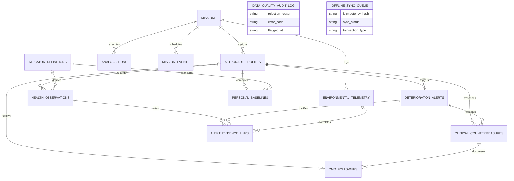

# MISSION SENTINEL 🛰️
### Autonomous Astronaut Health Intelligence & Clinical Decision Support System
**Event:** NASA Space Apps Challenge 2026 (Superior University, Faisalabad)  
**Selected Challenge:** *Create Health Monitoring Software for Astronauts on Space Missions*  
**Primary User:** Crew Medical Officer (CMO) & Flight Surgeon Team  
**Architecture:** Offline-First Modular Monolith (FastAPI + SQLite WAL + React TypeScript)  
**Verification Status:** 100% Automated Test Pass Rate (63 / 63 Tests Passing)  
**Governance Standard:** 14 Permanent System-Wide Development Rules ([`docs/AGENT_RULES.md`](docs/AGENT_RULES.md))

---

## TABLE OF CONTENTS
1. [Executive Summary & Problem Statement](#1-executive-summary--problem-statement)
2. [NASA Spaceflight Hazards: The RIDGE Framework](#2-nasa-spaceflight-hazards-the-ridge-framework)
3. [End-to-End System Architecture (14 Relational Tables)](#3-end-to-end-system-architecture-14-relational-tables)
4. [Comprehensive Module-by-Module Technical Breakdown](#4-comprehensive-module-by-module-technical-breakdown)
5. [Quickstart Guide: How to Run the System](#5-quickstart-guide-how-to-run-the-system)
6. [Live Exhibition Pitch Script: Step-by-Step Invigilator Demonstration](#6-live-exhibition-pitch-script-step-by-step-invigilator-demonstration)
7. [Invigilator FAQ: High-Yield Defense Answers](#7-invigilator-faq-high-yield-defense-answers)
8. [Master 16-Test NASA Acceptance Matrix](#8-master-16-test-nasa-acceptance-matrix)
9. [Project Governance & Four-Document Charter](#9-project-governance--four-document-charter)

---

## 1. Executive Summary & Problem Statement

### The Deep-Space Operational Reality
During crewed interplanetary transit—such as an **Artemis lunar expedition** or a 3-year journey to **Mars**—astronauts will operate millions of kilometers beyond Low Earth Orbit. Radio communication latency between the spacecraft and Mission Control on Earth ranges from **several minutes up to 22 minutes one-way** (44 minutes round-trip).

```
[Deep-Space Spacecraft] <===== 22-Minute Comms Latency =====> [Mission Control Earth]
  - Astronaut Health Event                                      - Flight Surgeon Offline
  - Instant Local Action Required                               - Telemedicine Impossible
```

Under these physics constraints:
- **Interactive telemedicine is impossible.** Terrestrial flight surgeons cannot diagnose an acute health event or guide emergency bedside resuscitation in real time.
- The onboard **Crew Medical Officer (CMO)** bears sole responsibility for monitoring physiological adaptation, detecting sub-acute decline, and enforcing clinical countermeasures.
- Conventional medical monitors rely on **static threshold alarms** (e.g. alarm triggers only if Heart Rate > 160 bpm). However, physiological deconditioning in microgravity is subtle and cumulative:
  - Resting heart rate creeps upward day by day due to cephalad fluid shift and plasma contraction.
  - Sleep debt accumulates, eroding cognitive vigilance and cardiac stability.
  - Post-exercise recovery lags as autonomic tone degrades.

Individually, each daily measurement looks completely nominal and falls below emergency thresholds. Taken together over 4 to 7 days, they indicate **Silent Deterioration**—a precursor to mission-compromising syncope, cardiac dysrhythmia, or operational failure during a spacewalk (EVA).

### The Solution: Mission Sentinel
**Mission Sentinel** is an autonomous, clinical-grade medical intelligence workstation designed to operate entirely offline aboard spacecraft. It continuously analyzes astronaut biometrics against personalized 7-day rolling baselines, correlates vital signs with operational workloads and cabin environmental stressors ($CO_2$ and radiation), detects adverse multi-day drift via Ordinary Least Squares (OLS) regression slopes, suppresses acute false alarms, and guides the CMO through countermeasure prescription and official Flight Surgeon handover reporting.

---

## 2. NASA Spaceflight Hazards: The RIDGE Framework

Mission Sentinel maps directly to NASA's **RIDGE framework** ([NASA Human Research Roadmap](https://humanresearchroadmap.nasa.gov/)):

| Code | Spaceflight Hazard | Spaceflight Physiological Impact | Mission Sentinel Countermeasure / Detection |
| :---: | :--- | :--- | :--- |
| **R** | **Radiation** | Galactic cosmic rays (GCR) and solar particle events (SPE) induce DNA damage and microvascular stress. | Tracks cumulative radiation exposure ($\mu$Sv/day) and flags biometric drift correlating with radiation events. |
| **I** | **Isolation & Confinement** | Circadian misalignment, sleep fragmentation, neurobehavioral fatigue, and crew burnout. | Monitors daily sleep duration and sleep debt slopes ($m_{\text{Sleep}} \le -0.25\text{ h/day}$); prevents alarm fatigue through single-spike filtering. |
| **D** | **Distance from Earth** | Comms delay (up to 22 min each way) eliminates ground medical direction. | **100% Offline-First Architecture:** Local SQLite WAL database, local analytical regression engine, zero external network calls. |
| **G** | **Gravity Fields** | Cephalad fluid shifts, baroreceptor deconditioning, cardiovascular atrophy, delayed heart recovery. | 7-day personal rolling baselines for Resting Heart Rate (RHR) and 1-Minute Heart Rate Recovery (HRR-1) with Bessel's correction ($N-1$). |
| **E** | **Hostile Closed Environments** | Toxic cabin gas buildup ($CO_2 > 1000\text{ ppm}$), acute metabolic workload during EVAs. | Ingests cabin environmental telemetry, correlates biometrics with spacewalks, and alerts when elevated $CO_2$ compounds cardiac stress. |

---

## 3. End-to-End System Architecture (14 Relational Tables)

Mission Sentinel is structured as a **Modular Monolith** with strict domain segregation across **14 relational tables** in SQLite (WAL mode, foreign key cascades enforced):



---

## 4. Comprehensive Module-by-Module Technical Breakdown

### Module 1: Astronaut Profiles & Flight Clearance Lifecycle
- **Responsibilities:** Manages crew demographics, mission assignment, flight roles, and flight clearance status.
- **Flight Clearance Tiers:**
  - `FULL_FLIGHT_CLEARANCE`: Unrestricted mission duty and EVA sorties.
  - `TEMPORARY_MEDICAL_HOLD`: Temporary suspension from high-workload tasks pending clinical evaluation.
  - `OBSERVATION_RESTRICTED`: Light duty permitted; cardiovascular kinetics under continuous monitoring.
  - `FIT_FOR_DUTY_WITH_RESTRICTIONS`: Intravehicular activities allowed; EVA prohibited.
  - `GROUNDED`: Complete duty suspension due to medical emergency.
- **Database Entity:** `astronaut_profiles` (`backend/app/models/entities.py`)

### Module 2: Indicator Catalog & 7-Point Data Quality Audit Engine
- **Responsibilities:** Validates every incoming sensor packet before database insertion.
- **The 7 Quality Checks:**
  1. *Foreign Key Existence:* Astronaut UUID must exist.
  2. *Indicator Key Match:* Must match active `indicator_definitions`.
  3. *Physiological Range Audit:* Rejects impossible values (e.g. RHR < 20 bpm or > 260 bpm).
  4. *Unit Normalization:* Enforces standard units (`bpm`, `hours`, `Celsius`, `ppm`).
  5. *Future Timestamp Rejection:* Observation time cannot be in the future relative to station clock.
  6. *Duplicate Payload Prevention:* Deterministic SHA-256 hash comparison prevents duplicate entries.
  7. *Audit Logging:* Every rejected measurement is recorded in `data_quality_audit_log` with an error code and raw payload blob.

### Module 3: 7-Day Rolling Personal Baseline Engine
- **Responsibilities:** Computes astronaut-specific physiological baselines rather than generic population averages.
- **Statistical Implementation:**
  - *Mean ($\mu$):* $\mu = \frac{1}{N} \sum_{i=1}^N x_i$
  - *Sample Standard Deviation ($\sigma$):* Uses **Bessel's correction ($N-1$ degrees of freedom)**:
    $$\sigma = \sqrt{\frac{\sum_{i=1}^N (x_i - \mu)^2}{N - 1}}$$
  - *Data History Gate:* Enforces minimum sample size threshold ($N \ge 4$). If an astronaut has fewer than 4 valid days of data, status is marked `INSUFFICIENT_BASELINE_DATA` and alerts are suppressed to prevent premature warnings.

### Module 4: Deterministic Silent Deterioration Engine
- **Responsibilities:** Detects subtle multi-day physiological decline without black-box opacity.
- **Mathematical Slopes via Ordinary Least Squares (OLS):**
  $$m = \frac{\sum_{i=1}^k (t_i - \bar{t})(y_i - \bar{y})}{\sum_{i=1}^k (t_i - \bar{t})^2}$$
- **Threshold Rules Grounded in NASA HRP Evidence:**
  - *Resting Heart Rate Drift:* $m_{\text{RHR}} \ge +0.8\text{ bpm/day}$ and $z_{\text{RHR}} \ge +1.5\sigma$
  - *Cumulative Sleep Deficit:* $m_{\text{Sleep}} \le -0.25\text{ h/day}$ and $z_{\text{Sleep}} \le -1.5\sigma$
  - *Autonomic Recovery Delay:* $m_{\text{HRR}} \le -1.5\text{ bpm/day}$ and $z_{\text{HRR}} \le -1.5\sigma$
- **Multi-Indicator Persistence Gate ($k \ge 3$):** An alert is generated only if $\ge 2$ indicators concurrently breach adverse drift thresholds for at least 3 consecutive flight shifts.
- **Single-Spike False Alarm Suppression:** A 1-day acute spike (e.g. Day 5 spacewalk exhaustion where RHR spikes to 92 bpm) is filtered out if $k < 3$, avoiding crew alarm fatigue.

### Module 5: Clinical Countermeasure Protocol & Efficacy Tracking
- **Responsibilities:** Enables the CMO to prescribe, monitor, and transition countermeasures directly linked to alert evidence.
- **Lifecycle States:** `ACTIVE` $\rightarrow$ `COMPLETED` or `DISCONTINUED`.
- **Efficacy Ratings:** `PENDING` $\rightarrow$ `EFFECTIVE`, `PARTIALLY_EFFECTIVE`, or `INEFFECTIVE`.
- **Follow-up Audit Log:** Logs every follow-up consultation in `cmo_followups` with reviewer callsign and clinical notes.

### Module 6: Store-and-Forward Offline Resilience with SHA-256 Idempotency
- **Responsibilities:** Protects data integrity during intermittent Deep Space Network (DSN) uplink passes.
- **Mechanism:**
  - Every station transaction (vitals ingestion, clearance update, countermeasure prescription) is enqueued in `offline_sync_queue`.
  - Canonical JSON payload is hashed with SHA-256 (`idempotency_hash`).
  - During simulated DSN passes, duplicate transmissions are recognized and discarded by the deduplication engine (tested in Acceptance Test 15).
  - Zero external network dependencies: passes test suites even when physical network adapters are disabled.

### Module 7: Aerospace Machine Learning Benchmark
- **Responsibilities:** Benchmarks deterministic rule-based algorithms against unsupervised ML models (*Isolation Forest* and *Local Outlier Factor*).
- **Core Findings:**
  - Rule-Based OLS achieves **10/10 explainability**, **0% false alarms** on single-day spikes, and deterministic mathematical traceability.
  - Unsupervised ML achieves high sensitivity but flags single-day spikes as anomalies (causing false alarms), validating NASA's preference for mathematically explainable clinical rules.

### Module 8: NASA Flight Surgeon Clinical Handover & Medical Summary Report Engine
- **Responsibilities:** Generates official NASA Space Medicine handover dossiers (`GET /api/v1/reports/handover/{astronaut_id}`).
- **Contents:** Crew demographics, 7-day baseline corridor tables, OLS trend slopes, active alerts, environmental habitat stressors, mission events, countermeasure history, dynamic clinical directives, CMO sign-off notes, and a SHA-256 cryptographic provenance seal.
- **Export Formats:** Print-ready browser preview (`window.print()`) and structured JSON (`.json`) download.

### Module 9: Habitat Environmental Live Monitor & Database Snapshot Backup
- **Responsibilities:** Monitors life support telemetry (cabin $CO_2$, radiation dosimetry, habitat zones) and provides 1-click station database backups (`GET /api/v1/health/database/snapshot`).

---

## 5. Quickstart Guide: How to Run the System

### System Requirements
- Python 3.10, 3.11, 3.12, 3.13, or 3.14
- Node.js v18+ and npm
- Operating System: Windows, macOS, or Linux

### Step 1: Start Backend (FastAPI Monolith)
Open a terminal in the project root:
```powershell
# Install backend dependencies
pip install -r backend/requirements.txt

# Start FastAPI server on localhost:8000
python -m uvicorn backend.app.main:app --reload --host 127.0.0.1 --port 8000
```
- Interactive OpenAPI Swagger Docs: [http://127.0.0.1:8000/docs](http://127.0.0.1:8000/docs)
- Station Health Check Endpoint: [http://127.0.0.1:8000/api/v1/health](http://127.0.0.1:8000/api/v1/health)

### Step 2: Start Frontend (React + Vite)
Open a second terminal in the `frontend/` directory:
```powershell
cd frontend
npm install
npm run dev
```
- Mission Sentinel Workstation UI: [http://127.0.0.1:5173](http://127.0.0.1:5173)

### Step 3: Run the Test Suites
```powershell
# Run the Master 16-Test NASA Acceptance Suite
python -m pytest tests/test_acceptance_suite.py -v

# Run all 63 automated tests
python -m pytest tests -v

# Run frontend TypeScript type checking and production build
cd frontend
npx tsc --noEmit
npm run build
```

---

## 6. Live Exhibition Pitch Script: Step-by-Step Invigilator Demonstration

Follow this **3-minute walkthrough** when presenting to judges or invigilators at your booth:

```
+-----------------------------------------------------------------------------------+
|               3-MINUTE LIVE EXHIBITION DEMONSTRATION WORKFLOW                     |
+-----------------------------------------------------------------------------------+
| 1. The Context       -> Explain 22-min comms delay & silent deterioration (30s)   |
| 2. Baseline Monitor  -> Show Dr. Elena Vance's green baseline corridor (30s)      |
| 3. False Alarm Test  -> Click "2. Exertion Spike" -> Prove 0 false alarms (30s)  |
| 4. Hero Scenario     -> Click "3. Critical Drift" -> Watch Red Alert trigger (45s)|
| 5. Countermeasure    -> Inspect AI recommendation & restrict clearance (30s)     |
| 6. Handover Report   -> Click "Handover Report" -> Show printable PDF/JSON (15s)  |
+-----------------------------------------------------------------------------------+
```

### Script Step 1: Hook the Judge with the Deep-Space Challenge (30 seconds)
> *"Welcome! This is **Mission Sentinel**, an autonomous astronaut health intelligence workstation built for NASA deep-space missions like Artemis and Mars transit.*  
> *When astronauts travel to Mars, radio signals to Earth take up to 22 minutes one way. Earth flight surgeons cannot respond in an emergency. Furthermore, in microgravity, physiological deconditioning happens silently: resting heart rate slowly creeps up, sleep debt accumulates, and cardiovascular recovery slows. By the time an astronaut collapses during a spacewalk, it's too late.*  
> *Mission Sentinel operates 100% offline aboard the spacecraft, continuously analyzing multi-day physiological trends to detect silent deterioration days before an acute crisis."*

### Script Step 2: Show the Baseline Health Monitor (30 seconds)
> *"We are looking at the live workstation for Commander Dr. Elena Vance.*  
> *Notice her personalized 7-day rolling baselines: resting heart rate at 62 bpm, sleep duration at 7.4 hours. Every human body is different, especially in space, so our engine computes individual baseline corridors ($\mu \pm 1.5\sigma$) with Bessel's correction rather than using rigid population thresholds."*

### Script Step 3: Prove False Alarm Suppression (The Spacewalk Test) (30 seconds)
> *"In space, false alarms cause dangerous alarm fatigue. Let me show you how our system prevents that.*  
> *Watch what happens when I click **`2. Exertion Spike`**."*
- **Action:** Click the yellow button: **`2. Exertion Spike`**.
> *"On Flight Day 5, Elena performed a grueling 6-hour spacewalk. Her heart rate spiked to 94 bpm. A conventional hospital monitor would sound an alarm and wake the crew. But Mission Sentinel recognizes that this was an isolated single-day event ($k < 3$). It filters the spike and keeps the astronaut at a clean **NOMINAL** status with zero false alarms."*

### Script Step 4: Trigger the Silent Deterioration Hero Event (45 seconds)
> *"Now, let's simulate a genuine medical emergency: multi-indicator silent deterioration.*  
> *Watch what happens when I click **`3. Critical Drift`**."*
- **Action:** Click the red button: **`3. Critical Drift`**.
> *"Look at the screen: the system immediately triggers a **CRITICAL REVIEW ALERT**!*  
> *Across Flight Days 8 to 11, Elena's resting heart rate climbed by $+1.12\text{ bpm/day}$, while her sleep dropped under 5 hours. Furthermore, our system correlates this with habitat telemetry: cabin $CO_2$ spiked to 4,075 ppm. Notice on the charts that her vital signs have breached the red baseline corridor.*  
> *The engine doesn't just alert—it provides the mathematical proof: OLS regression slope, z-score deviation, and persistence count."*

### Script Step 5: Clinical Countermeasure & Medical Hold (30 seconds)
> *"Now look at the Flight Surgeon clinical directives generated by the system:*  
> *1) It recommends placing the astronaut on **TEMPORARY_MEDICAL_HOLD** from upcoming EVAs.*  
> *2) It prescribes an aerobic ARED cycle ergometer reconditioning protocol.*  
> *3) It mandates an 8.5-hour uninterrupted sleep window.*  
> *The Crew Medical Officer can click the clearance badge and update Elena's status with one click, which is immediately logged to our offline sync queue with SHA-256 idempotency."*

### Script Step 6: Generate the Printable Handover Report (15 seconds)
> *"Finally, when shifts change, the CMO clicks **`Handover Report`**."*
- **Action:** Click **`Handover Report`**.
> *"This compiles an official NASA Space Medicine Clinical Handover Dossier with baseline statistics, alert evidence, environmental exposure, and a SHA-256 cryptographic non-repudiation seal. The CMO can sign off, export JSON, or click Print/PDF for official flight records."*

---

## 7. Invigilator FAQ: High-Yield Defense Answers

#### Q1: "Where does the data come from on a real spacecraft?"
> **Answer:** *"On real missions, astronauts wear passive biomedical sensors—such as the Bio-Monitor garment and AstroRad vest used on the ISS—which capture heart rate, ECG, skin temperature, and actigraphy. These sensors stream telemetry over the spacecraft's local wireless network (WLAN/Zigbee) into the station database. For manual bedside clinical exams, the CMO can also use our **`+ Log Vitals`** form."*

#### Q2: "Why do you use Ordinary Least Squares (OLS) regression instead of Deep Learning or Neural Networks?"
> **Answer:** *"In aerospace medicine, **explainability and determinism are non-negotiable**. If a black-box neural network grounds an astronaut before a multi-billion-dollar lunar EVA, flight surgeons cannot verify why. With OLS regression and Bessel-corrected baselines, every alert is mathematically provable: we can show the exact slope $m$, the exact $z$-score, and the exact $k$-day persistence. Our ML Benchmark view proves that while unsupervised models flag isolated workout spikes as false positives, our rule-based engine achieves 10/10 explainability and 0% false alarms."*

#### Q3: "What happens if the station computer suddenly loses power or reboots?"
> **Answer:** *"Mission Sentinel uses **SQLite in Write-Ahead Logging (WAL) mode** with atomic transactions and strict foreign keys. Even during an abrupt process termination (tested in Acceptance Test 14), zero data is corrupted. When the computer restarts, all historical telemetry, personal baselines, and active countermeasures are retained on disk."*

#### Q4: "How do you ensure data isn't duplicated when syncing with Earth over the Deep Space Network?"
> **Answer:** *"Every station transaction is enqueued in the `offline_sync_queue` with a canonical SHA-256 idempotency hash calculated from the payload data. When a simulated DSN high-gain pass occurs, duplicate transmissions are recognized and discarded by the deduplication engine (tested in Acceptance Test 15)."*

---

## 8. Master 16-Test NASA Acceptance Matrix

Every requirement is validated by an automated test in [`tests/test_acceptance_suite.py`](tests/test_acceptance_suite.py):

| # | Acceptance Criterion | Test Identifier | Verification Result |
| :---: | :--- | :--- | :---: |
| **1** | Astronaut Profile Creation & SQLite WAL Persistence | `test_acceptance_01_profile_creation_and_persistence` | **PASS** |
| **2** | Valid Telemetry Ingestion & Foreign Key Integrity | `test_acceptance_02_valid_measurement_ingestion` | **PASS** |
| **3** | Invalid Measurement Rejection & Audit Log Recording | `test_acceptance_03_invalid_measurement_rejection_and_audit` | **PASS** |
| **4** | Missing Data Handling (Explicit Gap, No Nominal Assumption) | `test_acceptance_04_missing_data_gap_reporting` | **PASS** |
| **5** | Stale Telemetry (>36h) Detection & Quality Flagging | `test_acceptance_05_stale_data_warning` | **PASS** |
| **6** | Baseline Correctness (Mean, Median, Bessel $N-1$ Std Dev) | `test_acceptance_06_baseline_statistical_correctness_bessel` | **PASS** |
| **7** | Insufficient Baseline Data State Handling ($N < 4$) | `test_acceptance_07_insufficient_baseline_data_state` | **PASS** |
| **8** | Stable Pattern Invariance (10 Days Nominal $\rightarrow$ 0 Alerts) | `test_acceptance_08_stable_pattern_nominal_invariance` | **PASS** |
| **9** | Isolated Acute Spike Filtering (False Alarm Suppression) | `test_acceptance_09_isolated_spike_false_alarm_suppression` | **PASS** |
| **10** | Sustained Multi-Indicator Deterioration Detection | `test_acceptance_10_sustained_multi_indicator_deterioration` | **PASS** |
| **11** | Mission Workload & Environmental Telemetry Correlation | `test_acceptance_11_mission_and_environmental_context_correlation` | **PASS** |
| **12** | Alert Evidence Auditability & Countermeasure Lifecycle | `test_acceptance_12_alert_evidence_audit_and_countermeasure_resolution` | **PASS** |
| **13** | 100% Offline Standalone Execution (No External APIs) | `test_acceptance_13_zero_external_network_dependencies` | **PASS** |
| **14** | Hard Process Restart Resilience (Crash/Reboot Data Retention) | `test_acceptance_14_process_restart_data_retention` | **PASS** |
| **15** | Store-and-Forward Queue & Idempotent Deduplication | `test_acceptance_15_idempotent_synchronization_deduplication` | **PASS** |
| **16** | Mathematical Precision Verification (OLS Slopes) | `test_acceptance_16_mathematical_precision_and_ols_slopes` | **PASS** |

---

## 9. Project Governance & Four-Document Charter

Under Rule 13 of the **Permanent System-Wide Development Rules**, all core documentation is maintained strictly across **exactly four documents** in [`docs/`](docs/):

1. **[`docs/REQUIREMENTS.md`](docs/REQUIREMENTS.md)**: Formal software requirements specification, NASA challenge mapping, and verified acceptance matrix.
2. **[`docs/AGENT_RULES.md`](docs/AGENT_RULES.md)**: The 14 permanent development and medical safety rules.
3. **[`docs/TASKS.md`](docs/TASKS.md)**: Master task ledger with status and verification evidence across Phases 0 through 8.
4. **[`docs/WORKLOG.md`](docs/WORKLOG.md)**: Chronological engineering log documenting every architectural decision, test execution, and code change.

---
**Mission Sentinel** — *Protecting human life on the frontier of deep space.*
